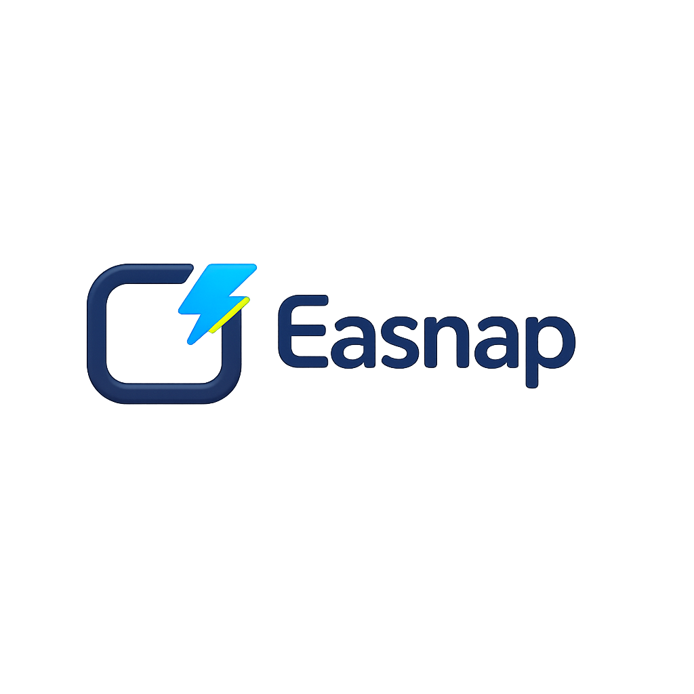
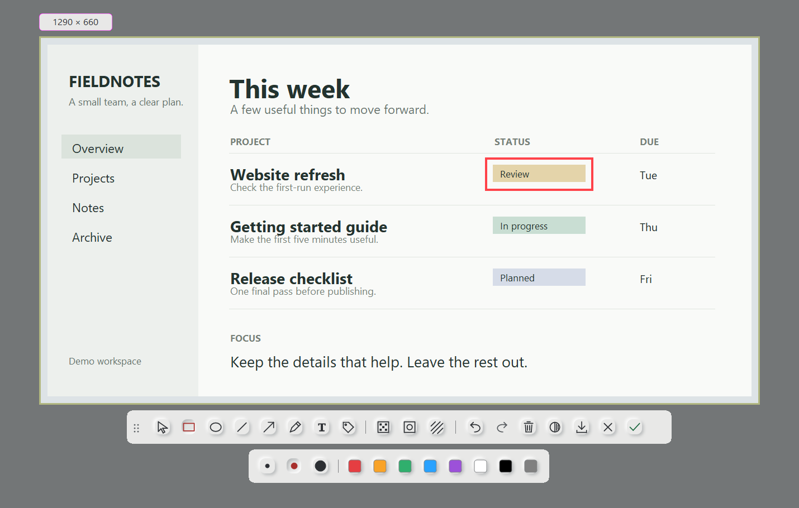
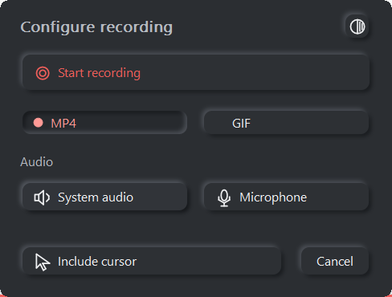
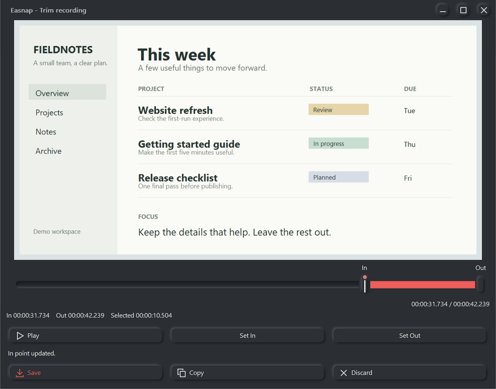

<p align="center">
  
</p>

<p align="center">Screenshots, scrolling screenshots, annotations and screen recordings for Windows.</p>

<p align="center">
  <a href="https://github.com/vseprr/easnap/releases/latest">Download</a> ·
  <a href="https://github.com/vseprr/easnap/releases">All releases and betas</a> ·
  <a href="#planned">Planned features</a>
</p>

Easnap lives in the system tray. Select part of your screen, add a few annotations,
and copy the result. Or record a short clip, trim it, and save it as MP4 or GIF.
Capture, editing and export run locally, with no account, telemetry or network
connection.

> **v1.1.0-beta.1 is a prerelease.** It adds Scrollshot, a Settings window, a
> Turkish interface, a local log and crash reports, and it no longer loses
> unsaved work on exit, sign-out or a crash. Everything marked *beta* below is
> in that version only; the latest stable version is v1.0.2. Betas are on the
> [releases page](https://github.com/vseprr/easnap/releases) and are not
> offered as the latest release.



## Capture and annotate

Select a monitor or draw a custom region. Adjust the frame before taking the
screenshot, then work at the image's original resolution.

- Draw with pen, lines, arrows, rectangles and ellipses.
- Add text and tags, mark an area with Spotlight, or apply a repeated watermark.
- Use Blur or Pixelate with a brush or an editable region.
- Move and edit annotations, undo changes, and copy or save as PNG/JPEG.
- Read a pixel's RGB or HEX value with the selection magnifier.

## Scrollshot (beta)

Capture more than fits on the screen: draw a frame over a page, list or
document, press Start and scroll the content yourself. Easnap joins what passes
through the frame into one tall image.

- Scroll with the wheel, the keyboard or the scroll bar; fixed headers and
  footers are taken once, and the mouse cursor never enters the image.
- A live preview shows the image growing. If Easnap loses track, scroll back a
  little and continue.
- Copy or save the result, or open it in the editor: every annotation tool
  works on the tall image, with scrolling and zoom.
- Scrolling is manual and vertical. Easnap does not scroll the application for
  you.

## Record, trim and export

Choose MP4 or GIF before recording. Include the cursor when useful, pause while
you prepare the next step, and stop when the clip is ready. Paused time is left
out of the recording.

| Option | Available in v1 |
|---|---|
| MP4 | H.264 video with optional AAC audio |
| Audio | System audio, microphone, both, or neither |
| GIF | Silent animation with High quality and Low size presets |
| Trim | Preview playback, seek, and set In/Out points before export |
| Finish | Save to a chosen location or copy the recording file to the clipboard |



*Recording options stay available before you press Start.*



*Preview the recording and adjust its start and end before saving.*

## Download and run

Easnap needs **Windows 10 version 2004 (build 19041) or later, x64**. It is
developed and tested on Windows 10 22H2. Windows 11 is expected to work; the
project has not tested it. On the N and KN editions of Windows the beta takes
screenshots and Scrollshots as it is, and records once the Media Feature Pack
is installed; v1.0.2 does not start there without it.

The [latest release](https://github.com/vseprr/easnap/releases/latest) offers
two equivalent packages built from the same binaries:

| Package | Use it when |
|---|---|
| `Easnap-v<version>-windows-x64-setup.exe` | You want one file to run: it installs for your user only, without administrator rights, and adds a Start menu entry and an uninstaller. |
| `Easnap-v<version>-windows-x64.zip` | You want a portable copy: extract the whole ZIP and run `bin\Easnap.exe`. Keep `EasnapPreviewHost.exe` beside it; the preview helper is part of the application. |

Then press **Ctrl+Shift+A**, or choose **Capture** from the tray menu. In the
beta the shortcut, the language (English or Turkish), the appearance, the
folders for screenshots and recordings and starting with Windows are in
**Settings...** in the same menu.

The binaries are unsigned, so Windows may display a publisher or reputation
warning. Each package has a `.sha256` file in the same release:

```powershell
Get-FileHash .\Easnap-v1.0.2-windows-x64-setup.exe -Algorithm SHA256
```

Compare the result with the value in the matching `.sha256` file. Releases from
v1.0.1 also carry a build provenance attestation, which ties a file to the
workflow run that built it:

```powershell
gh attestation verify .\Easnap-v1.0.2-windows-x64-setup.exe --repo vseprr/easnap
```

To update, exit Easnap, then run the new installer or extract the new ZIP into a
separate folder. Always use the application and preview helper from the same
release. A beta installs over a stable version and uses the same settings; it
is not a second copy beside it. To remove an installed copy, use **Settings >
Apps** in Windows (**Installed apps** on Windows 11, **Apps & features** on
Windows 10); for the portable one, exit Easnap and delete the extracted folder.
Settings, the log and temporary recordings are stored separately under
`%LOCALAPPDATA%\Easnap`; **Open data folder** in the tray shows the location.
v1.0.2 keeps them on removal. The uninstaller of the beta asks whether to
remove settings, log and crash reports, and never removes a recording that was
not saved.

## First capture

1. Press **Ctrl+Shift+A**, then click a monitor or drag a region.
2. Adjust the frame. Choose an annotation tool to capture the image and begin
   editing, or choose **Record** before starting a screenshot edit.
3. For a screenshot, use **Ctrl+C** to copy or **Ctrl+S** to save. For a
   recording, press **Start**, then **Stop** to open the preview and trim window.

| Shortcut | Action |
|---|---|
| Ctrl+Shift+A | Open or return to the capture workspace |
| Ctrl+C / Ctrl+S | Copy / save the screenshot |
| Ctrl+Z / Ctrl+Y | Undo / redo an annotation edit |
| Esc | Cancel a capture; stop and finalize a recording while its island has the keyboard |

Text editing and active gestures handle these keys in their own context. See
the [full input reference](docs/user-flows.md#keyboard-reference) for details.
Light and Dark appearance are available from the tray and capture controls; the
beta can also follow Windows. If something does not work, see
[troubleshooting](docs/troubleshooting.md).

## Known limitations

- Transient redraw artifacts can occur while resizing or maximizing the Trim
  window.
- Physical testing covers two 1920x1080 displays at **125% scaling** (144 Hz
  and 60 Hz). Layout at other resolutions and scale factors is covered by
  automated layout tests only; other GPUs, audio devices, mixed-DPI layouts and
  accessibility tools have not been checked on real hardware.
- Windows 11, the N editions of Windows and HDR displays have not been tested by
  the project.
- Scrollshot (beta) has been verified on a test document only, not yet on
  browsers, editors or lists that load while they scroll.
- GIF preview plays the source recording. Its final palette and frame cadence
  are applied during export; GIF has no audio.
- MP4 cut points follow video/audio sample granularity. A trim near the end of a
  long recording can take longer because decoding starts at the source beginning.

See the [release notes](https://github.com/vseprr/easnap/releases/latest) and
[project status](docs/project-status.md) for validation results and remaining work.

## Planned

| Feature | Direction |
|---|---|
| **Scrollshot** | In v1.1.0-beta.1. Automatic scrolling and horizontal capture are not planned for v1.1. |
| **OCR** | Extract text from screenshots; planned after v1, with no release date set. |
| Compatibility and accessibility | Extend testing across Windows versions, displays, audio devices and keyboard workflows. |

OCR is **not included**. The [roadmap](EASNAP_ROADMAP.md) records the current
priorities and release boundaries.

## Development

Easnap is written in **C++20** using the Windows SDK, with no third-party runtime
dependencies. Build with Visual Studio 2022, the Desktop development with C++
workload, a Windows SDK and CMake 3.20 or later:

```powershell
.\scripts\build.ps1                 # build, then run the tests affected by your change
.\build\bin\Release\Easnap.exe    # run the development build directly
```

Tests are split into tiers so a normal run does not use your pointer, keyboard
or screen; the few that need the real desktop run on a display you choose. The
project runs the Standard and Full tiers in a Hyper-V test lab with a desktop
of its own, described in the [testing guide](docs/testing.md#lab). See
the [testing guide](docs/testing.md), the
[development guide](docs/development.md) for building and packaging,
[architecture](docs/architecture.md) for the code structure, and
[project status](docs/project-status.md) before starting changes.

## Privacy and license

Settings and private temporary recordings stay in the current user's local
application-data directory. Copied recording files remain available while the
clipboard references them, including after the application closes. Saving
creates a file at the destination you choose. The beta also keeps a log and,
after a crash, a crash report in that directory; neither contains what was on
your screen, and nothing is sent anywhere. "Check for updates" opens the
releases page in your browser; Easnap itself connects to nothing.

For security details and reporting, see [SECURITY.md](SECURITY.md).
Easnap is available under the [MIT License](LICENSE).

